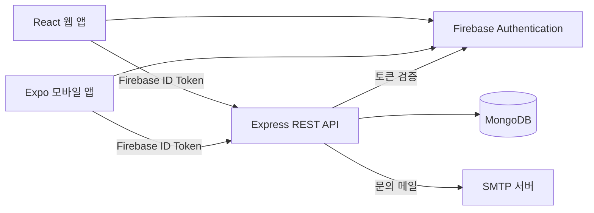

# 📝 Don't Forget  

**Don't Forget**은 할 일을 날짜와 카테고리별로 정리하고 진행 상황을 확인할 수 있는 개인용 투두리스트 프로젝트입니다.
<br>
React 기반 웹 클라이언트와 Expo/React Native 모바일 앱이 하나의 Express API와 MongoDB를 사용합니다.
<br>
Firebase Authentication으로 웹과 모바일의 이메일 계정을 관리하며, 인증된 사용자의 데이터만 API에서 읽고 수정하도록 구성했습니다.
<br>
<br>

## ✨ 주요 기능  

### 웹 클라이언트

- Firebase 이메일·비밀번호 회원가입 및 로그인
- Firebase 이메일 비밀번호 재설정
- 날짜별 할 일 생성, 조회, 수정, 완료 처리, 삭제
- 월간 캘린더에서 날짜 선택, 선택한 날짜 또는 전체 일정 보기
- 카테고리 및 키워드 검색 필터
- 날짜별 완료 수와 달성률 표시, 달성률 100% 도달 시 축하 애니메이션
- 브라우저 알림 권한을 허용한 경우 새 할 일 등록 알림
- 프로필 이름, 상태 메시지, 프로필 이미지 수정 및 완료한 할 일 수 표시
- 라이트·다크·시스템 테마 설정
- 한국어, 영어, 일본어, 중국어, 독일어, 스페인어, 프랑스어, 태국어 지원
- SMTP를 통한 관리자 문의 접수

### 모바일 앱

- Firebase 이메일·비밀번호 회원가입 및 로그인, 비밀번호 재설정
- 할 일 추가, 목록 조회, 내용·카테고리·마감일 수정, 완료 처리 및 삭제
- 카테고리와 키워드로 목록 필터링
- 프로필 이름과 상태 메시지 수정, 사진 보관함에서 프로필 이미지 선택
- 완료한 할 일 수 확인
- 관리자 문의 접수
- React Navigation을 이용한 로그인 상태 기반 화면 전환

### 서버 및 데이터

- MongoDB에 사용자 프로필과 할 일 데이터 저장
- Firebase ID 토큰 검증 후 API 요청 처리
- 인증된 Firebase UID를 기준으로 사용자별 할 일과 프로필 접근 제어
- 프로필 입력값과 이미지 크기 검증
- 문의 이메일 SMTP 발송 및 계정별 요청 제한(15분당 최대 5회)
- 사용자 식별자에 대한 고유 부분 인덱스 확인 및 준비

## ⚙️ 시스템 구성



웹과 모바일은 Firebase Authentication에서 발급한 ID 토큰을 `Authorization: Bearer <token>` 헤더로 API에 전달합니다. 서버는 토큰의 서명과 프로젝트 정보, 만료 여부를 검증한 뒤 Firebase UID를 사용자 데이터의 소유자 키로 사용합니다.
<br>
<br>
## 🔥 기술 스택

| 영역 | 기술 |
| --- | --- |
| 웹 클라이언트 | React 18, React DOM, Vite 5, React Router 6 |
| 웹 상태·화면 기능 | Zustand 5, `react-calendar` 5, `canvas-confetti`, CSS |
| 웹 인증·다국어 | Firebase JavaScript SDK 12, React Context API |
| 모바일 클라이언트 | Expo SDK 57, React Native 0.86, React 19 |
| 모바일 내비게이션·상태 | React Navigation 7, Zustand 5 |
| 모바일 API·인증 | Axios, Firebase JavaScript SDK, AsyncStorage |
| 모바일 기기 기능 | Expo Image Picker |
| 서버 | Node.js 20.19 이상, Express 5 |
| 데이터 계층 | MongoDB, Mongoose 9 |
| 인증·보안 | Firebase ID Token, `jsonwebtoken`의 RS256 검증, Node.js `crypto` |
| 메일·환경 설정 | Nodemailer, dotenv |
| 품질 확인 | ESLint, Node.js 구문 검사, Vite 프로덕션 빌드 |

<br>

## API 개요
<br>
기본 주소는 `http://localhost:3000/api`입니다. 실제 배포 또는 모바일 기기에서 접근할 때는 환경에 맞는 API 주소를 설정해야 합니다.

| 메서드 | 경로 | 설명 |
| --- | --- | --- |
| `GET` | `/todos` | 로그인 사용자의 할 일 목록 조회 |
| `GET` | `/todos/:userId` | UID 소유자 확인 후 할 일 목록 조회 |
| `POST` | `/todos` | 할 일 추가 |
| `PUT` | `/todos/:id` | 할 일 수정 또는 완료 상태 변경 |
| `DELETE` | `/todos/:id` | 할 일 삭제 |
| `GET` | `/users/:uid` | 프로필 조회 |
| `PUT` | `/users/:uid` | 프로필 생성 또는 수정 |
| `POST` | `/contact` | 관리자 문의 전송 |

할 일과 프로필 API는 Firebase ID 토큰 인증을 요구합니다. 서버에는 기존 계정과의 호환을 위한 로컬 `/login`, `/signup` 경로도 남아 있으며, 현재 웹·모바일 클라이언트의 기본 인증 흐름은 Firebase 이메일 인증을 사용합니다.
<br>
<br>
## 🌳 저장소 구조  

```text
.
├── dont-forget-server/
│   ├── src/
│   │   ├── config/                 # MongoDB 연결 및 사용자 인덱스 준비
│   │   ├── features/
│   │   │   ├── todos/              # 할 일 모델, 컨트롤러, 라우트
│   │   │   └── users/              # 사용자 모델, 프로필 및 계정 API
│   │   └── middleware/             # Firebase 토큰 검증, 접근 제어, 문의 제한
│   └── scripts/                    # 레거시 비밀번호 마이그레이션
└── dont-forget-web/
    ├── src/
    │   ├── app/                    # 웹 앱 라우팅 및 진입점
    │   ├── features/               # 인증, 할 일, 프로필, 문의, 환경 설정
    │   └── shared/                 # 공통 UI, Firebase, 다국어, 유틸리티
    └── dont-forget-mobile/
        └── src/
            ├── features/           # 모바일 인증, 할 일, 프로필, 문의
            ├── navigation/         # React Navigation 화면 구성
            ├── services/           # Firebase 및 API 클라이언트
            └── shared/             # 공용 폼 컴포넌트와 유틸리티
```
<br>

## 💡 시작하기

### 사전 준비

- Node.js 20.19 이상 및 npm
- MongoDB 연결 URI
- Firebase 프로젝트에서 이메일/비밀번호 로그인 제공자 활성화
- 웹 및 모바일 클라이언트에 사용할 Firebase 앱 설정

저장소 루트에는 공통 `package.json`이 없습니다. 각 앱과 서버 폴더에서 의존성을 설치하고 실행합니다.

### 1. 서버 실행

```bash
cd dont-forget-server
npm ci
```

`.env.example`을 `.env`로 복사한 뒤 값을 채웁니다.

```dotenv
MONGO_URI=mongodb+srv://<user>:<password>@<cluster>/<database>
JWT_SECRET=<최소 32바이트의 임의 값>
FIREBASE_PROJECT_ID=<Firebase 프로젝트 ID>
PORT=3000
DNS_SERVERS=8.8.8.8,8.8.4.4

# 관리자 문의 메일을 사용할 때 설정
SMTP_USER=
SMTP_PASS=
CONTACT_TO=
```

`JWT_SECRET` 생성 예시:

```bash
node -p "require('node:crypto').randomBytes(32).toString('base64url')"
```

서버를 시작합니다.

```bash
npm start
```

서버는 MongoDB 연결과 사용자 인덱스 준비를 마친 뒤 API 요청을 받습니다. 기본 포트는 `3000`입니다. 문의 기능을 사용하려면 SMTP 설정을 추가해야 합니다.

### 2. 웹 앱 실행

```bash
cd dont-forget-web
npm ci
```

`.env.example`을 `.env`로 복사하고 Firebase 웹 앱 값을 설정합니다.

```dotenv
VITE_FIREBASE_API_KEY=
VITE_FIREBASE_AUTH_DOMAIN=
VITE_FIREBASE_PROJECT_ID=
VITE_FIREBASE_STORAGE_BUCKET=
VITE_FIREBASE_MESSAGING_SENDER_ID=
VITE_FIREBASE_APP_ID=
VITE_API_URL=http://localhost:3000/api
```

```bash
npm run dev
```

프로덕션 빌드와 로컬 미리보기:

```bash
npm run build
npm run preview
```

### 3. 모바일 앱 실행

```bash
cd dont-forget-web/dont-forget-mobile
npm ci
```

`.env.example`을 `.env`로 복사하고 `EXPO_PUBLIC_FIREBASE_*` 값을 설정합니다. `EXPO_PUBLIC_API_URL`에는 모바일 기기에서 접근 가능한 API 주소를 지정합니다.

```dotenv
EXPO_PUBLIC_API_URL=http://192.168.1.10:3000/api
EXPO_PUBLIC_FIREBASE_API_KEY=
EXPO_PUBLIC_FIREBASE_AUTH_DOMAIN=
EXPO_PUBLIC_FIREBASE_PROJECT_ID=
EXPO_PUBLIC_FIREBASE_STORAGE_BUCKET=
EXPO_PUBLIC_FIREBASE_MESSAGING_SENDER_ID=
EXPO_PUBLIC_FIREBASE_APP_ID=
```

```bash
npm start
```

실제 휴대전화에서 실행할 때 `localhost`는 개발 컴퓨터가 아니라 휴대전화를 가리킵니다. 컴퓨터와 휴대전화를 같은 네트워크에 연결하고, `EXPO_PUBLIC_API_URL`에 컴퓨터의 LAN IP 주소를 입력하세요. Android 에뮬레이터의 기본 API 주소는 `http://10.0.2.2:3000/api`입니다.
<br>
<br>
## ✅ 확인 명령

각 폴더에서 실행합니다.

```bash
# dont-forget-server
npm run check

# dont-forget-web
npm run build

# dont-forget-mobile
npm run lint
```
