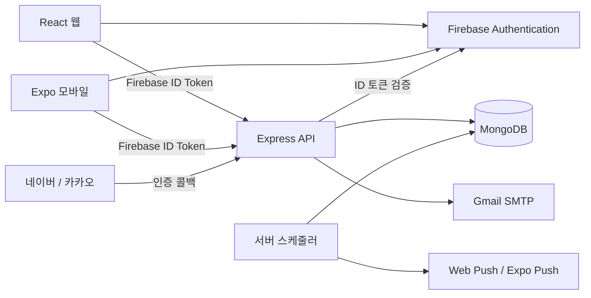

# 📝 Don't forget

할 일을 날짜와 카테고리별로 관리하고, 반복 루틴·일기·완료 기록으로 하루를 돌아보는 개인 일정 관리 프로젝트입니다.

React 웹과 Expo/React Native 모바일 앱이 하나의 Express API와 MongoDB를 사용합니다. Firebase Authentication의 UID를 기준으로 사용자 데이터를 구분하며, 같은 Firebase 계정으로 접속하면 웹과 모바일에서 같은 서버 데이터를 조회합니다.

> 기능 목록은 현재 저장소에 구현된 코드를 기준으로 작성했습니다. 외부 서비스 설정이나 실기기 확인이 필요한 기능은 아래 **현재 확인 상태**에 별도로 표시했습니다.

## 주요 기능

### 할 일 관리

- 날짜·마감 시각·카테고리를 지정해 할 일 생성
- 할 일 조회·내용 수정·완료 처리·삭제
- 키워드 검색과 카테고리 필터
- 웹: 날짜별·전체 목록, 주간 날짜 선택, 월간 캘린더
- 모바일: 오늘·예정·완료·모든 할 일 분류 및 날짜 선택
- 완료 수와 일일 달성률 표시, 웹에서 100% 달성 시 축하 애니메이션
- 할 일 카드에 마감 날짜·시각과 미리 알림 설정 표시
- 하나의 할 일에 여러 미리 알림 간격 추가: **1분~30일 전, 최대 10개**

현재 카테고리는 웹·모바일 공통으로 다음 12개입니다.

💼 근무 · 🏃 운동 · 📅 예약 · 📚 공부 · 🤝 약속 · 🏫 학교생활 · 🧑‍💻 개발/프로젝트 · 🏠 집안일 · 🛒 쇼핑 · 📖 숙제/과제 · 👥 친목/모임 · ✨ 기타

### 반복 루틴

- 매일 또는 매주 선택한 요일에 반복하는 루틴 등록
- 시작일·종료일(선택)·마감 시각 설정
- 루틴 목록 조회·중지·재개·삭제
- 서버 스케줄러가 반복 조건에 따라 할 일 생성

현재 스케줄러는 루틴의 지정 시각에 할 일을 생성합니다. 해당 날짜의 할 일을 하루 시작 전에 미리 생성하는 방식은 아니며, 루틴에서 생성되는 할 일의 사전 알림 동작은 추가 검토가 필요합니다.

### 일기

- 월간 달력에서 날짜 선택
- 선택한 날짜에 등록·마감·완료한 할 일 확인
- 일기가 작성된 날짜와 할 일이 있는 날짜 표시
- 날짜별 제목·본문 저장 및 조회·수정·삭제
- 줄 노트 형태의 팝업 작성 화면과 열기 애니메이션
- 작성된 일기는 보기 상태로 열고, 수정 버튼을 눌러 편집
- 일기가 있는 날짜는 플로팅 버튼을 ‘일기 보기’로 표시

### 티어와 명예의 전당

티어는 **티어 점수**, 명예의 전당 순위는 **역대 누적 완료 수**를 기준으로 계산합니다.

| 티어 | 필요한 누적 티어 점수 |
| --- | ---: |
| 브론즈 | 0 |
| 실버 | 30 |
| 골드 | 60 |
| 플래티넘 | 90 |
| 다이아 | 120 |
| 에메랄드 | 150 |
| 마스터 | 180 |
| 그랜드 마스터 | 210 |
| 챌린저 | 240 |

- 티어 점수는 사용자의 설정 시간대를 기준으로 **하루 최대 3점** 인정
- 같은 할 일을 완료 취소 후 다시 완료해도 중복 점수·누적 완료 수를 지급하지 않도록 완료 이벤트 저장
- 일일 한도를 초과한 완료도 역대 누적 완료 수에는 반영
- 다음 티어까지 필요한 점수와 오늘 인정된 점수 표시
- 누적 완료 수 내림차순으로 최대 100명 조회, 동률이면 계정 생성 시각 오름차순
- 상위 3명 메달, 티어별 훈장과 티어 색상 테두리 효과
- 웹 프로필에는 완료 수와 현재 티어 표시

### 계정·프로필·문의

- 웹·모바일: Firebase 이메일/비밀번호 회원가입·로그인·비밀번호 재설정
- 이름을 이용한 아이디 찾기 화면과 서버 조회 API
- 웹: Google 로그인
- 웹·모바일: 네이버·카카오 OAuth 진입 및 Firebase 커스텀 토큰 로그인 흐름
- 프로필 이름·상태 메시지·프로필 이미지 조회 및 수정
- 모바일 사진 보관함에서 프로필 이미지 선택
- Gmail SMTP를 통한 관리자 문의, 계정별 15분당 최대 5회 요청 제한

네이버·카카오는 제공자 앱 등록·콜백 URL·서비스 계정 키 등 외부 설정을 완료해야 사용할 수 있습니다. 설정 방법은 [SOCIAL_LOGIN_SETUP.md](SOCIAL_LOGIN_SETUP.md)를 참고하세요.

### 화면과 환경 설정

- 대표 색상 `#2B6CB0`, 라이트·다크·시스템 테마
- 웹 인증 페이지와 일기 작성 팝업에도 선택한 테마 반영
- 웹 창 크기에 맞춘 전체 화면 배경과 반응형 콘텐츠 레이아웃
- 웹 인증 페이지를 제외한 화면에서 메뉴를 열어 다른 페이지로 이동
- 모바일 기기 폭·회전·안전 영역에 맞춘 공통 여백, 읽기 쉬운 글자와 터치 영역
- 모바일 콘텐츠·입력 화면·팝업의 세로 스크롤 및 키보드 대응
- 웹에 한국어·영어·일본어·중국어·독일어·스페인어·프랑스어·태국어 번역 사전 제공

모바일 UI는 현재 한국어 중심이며, 웹도 일부 신규 화면·메시지에 한국어 고정 문구가 남아 있습니다.

## 현재 확인 상태

| 항목 | 구현 및 확인 범위 |
| --- | --- |
| 브라우저 미리 알림 | 구독 등록, 예약 계산, 서버 전송 구현. 웹 푸시 서비스 접수 성공 로그까지 확인했으나 Chrome 화면에 알림이 표시되지 않는 문제는 조사 보류 상태 |
| 모바일 원격 푸시 | Expo 토큰 등록·서버 전송 경로 구현. Android Expo Go에서는 등록을 차단하고 development build 안내. EAS `projectId`와 네이티브 빌드 설정 및 기기 검증 필요 |
| 네이버·카카오 로그인 | 클라이언트·서버 흐름 구현. 실제 제공자 키와 콜백 설정 및 로그인 검증 필요 |
| 모바일 API 연결 | 이전 PC IP 고정값을 제거하고 Expo LAN 호스트 자동 탐지 적용. PC의 LAN 주소에서 백엔드 HTTP 응답 확인. 수정 후 휴대폰의 전체 기능 재확인 필요 |

알림·루틴 스케줄러는 **백엔드 실행 중 30초마다** 동작합니다. 완료된 할 일과 마감 시각이 지난 할 일은 미리 알림 전송 대상에서 제외됩니다. 푸시 서비스의 요청 접수 성공은 기기 화면의 알림 표시 성공을 보장하지 않습니다.

## 시스템 구성



보호된 API는 `Authorization: Bearer <Firebase ID Token>` 헤더를 사용합니다. 서버는 토큰의 서명·만료·Firebase 프로젝트를 검증하고, 요청의 인증 UID를 데이터 소유자 기준으로 사용합니다.

## 기술 스택

아래 버전은 각 프로젝트의 `package.json` 선언을 기준으로 합니다.

| 영역 | 기술 |
| --- | --- |
| 웹 | React 18, Vite 5, React Router 6, Zustand 5, Firebase SDK 12 |
| 웹 UI | CSS, react-calendar 5, canvas-confetti |
| 모바일 | Expo SDK 58, React Native 0.88, React 19.3 |
| 모바일 UI·기기 기능 | React Navigation 7, Safe Area Context, AsyncStorage, Expo Image Picker·Notifications·Constants |
| 모바일 통신 | Axios 1, Firebase SDK 12, 공통 API 클라이언트 |
| 서버 | Node.js, Express 5, Mongoose 9, MongoDB |
| 인증·메일·푸시 | jsonwebtoken, Node.js crypto, Nodemailer, web-push |

## 프로젝트 구조

```text
.
├── README.md
├── ARCHITECTURE.md                  # 수정할 기능별 파일 위치 안내
├── SOCIAL_LOGIN_SETUP.md            # 네이버·카카오 설정
├── dont-forget-server/
│   ├── server.js                    # 환경변수·DB·스케줄러·서버 시작
│   ├── scripts/                     # 레거시 비밀번호 마이그레이션
│   └── src/
│       ├── config/                  # DB 연결 및 인덱스 준비
│       ├── middleware/              # 인증·소유자 확인·문의 제한
│       ├── services/                # 알림·루틴 스케줄러, 푸시 전송, 완료 기록 보정
│       ├── shared/                  # 날짜·시간대 계산
│       └── features/
│           ├── auth/                # 소셜 OAuth
│           ├── todos/               # 할 일 및 마감·알림·완료 점수 규칙
│           ├── routines/            # 반복 일정 및 입력 검증
│           ├── journals/            # 일기
│           ├── leaderboard/         # 티어·누적 순위
│           ├── notifications/       # 푸시 구독·토큰 등록
│           └── users/               # 계정·프로필·문의·완료 이벤트 모델
└── dont-forget-web/
    ├── public/service-worker.js     # 브라우저 푸시 수신
    ├── src/
    │   ├── app/                     # 라우팅·전역 테마 반영
    │   ├── features/                # auth, todos, profile, admin, extras, preferences
    │   │   └── todos/
    │   │       ├── pages/           # 메인 화면 조합
    │   │       ├── components/      # header, composer, list, calendar, filters 등
    │   │       └── styles/          # 화면 배치·반응형 스타일
    │   └── shared/                  # 공통 레이아웃·다국어·Firebase·스타일
    └── dont-forget-mobile/
        ├── app.json                 # Expo·딥링크·네이티브 플러그인 설정
        └── src/
            ├── navigation/          # 로그인 상태별 화면 전환·안전 영역 Provider
            ├── features/            # 인증·할 일·프로필·문의·루틴·일기·랭킹
            ├── services/
            │   ├── api/             # API 주소 결정·공통 요청·오류 처리
            │   ├── firebase/
            │   └── notifications/
            └── shared/
                ├── components/      # 폼·버튼
                ├── layout/          # 기기 크기·공통 가독성 기준
                ├── theme/
                └── utils/
```

더 자세한 편집 위치는 [ARCHITECTURE.md](ARCHITECTURE.md)를 참고하세요. 루트에도 `package.json`이 있지만, 통합 실행 스크립트나 npm workspace 구성은 없습니다. **서버·웹·모바일 폴더에서 각각 의존성을 설치하고 실행**합니다.

## 로컬 실행

### 준비 사항

- 서버는 Node.js `20.19` 이상. 모바일까지 함께 개발할 때는 설치된 React Native의 Node 범위에 맞춰 **22.13 이상인 22.x 또는 24.3 이상인 24.x** 사용 권장
- MongoDB 연결 URI. 완료 처리의 트랜잭션을 위해 **replica set 또는 MongoDB Atlas** 사용
- Firebase 프로젝트에서 이메일/비밀번호 제공자 활성화. 웹 Google 로그인은 Google 제공자와 인증 허용 도메인도 설정
- 웹·모바일·서버의 Firebase 프로젝트를 동일하게 설정
- 모바일 실기기 LAN 테스트는 PC와 휴대폰을 같은 Wi-Fi에 연결

아래 명령은 저장소 루트에서 시작하는 PowerShell 기준입니다. 최초 설정 시 각 폴더의 `.env.example`을 `.env`로 복사하고 값을 입력합니다. 이미 설정한 `.env`가 있으면 기존 값을 유지하세요.

### 1. 백엔드

```powershell
cd dont-forget-server
npm ci
Copy-Item .env.example .env
```

필수 환경변수는 `MONGO_URI`, `JWT_SECRET`, `FIREBASE_PROJECT_ID`입니다. 기본 포트는 `3000`이며 추가 항목은 [서버 환경변수 예제](dont-forget-server/.env.example)를 참고하세요.

```dotenv
MONGO_URI=mongodb+srv://<user>:<password>@<cluster>/<database>
JWT_SECRET=<32바이트 이상의 임의 값>
FIREBASE_PROJECT_ID=<Firebase 프로젝트 ID>
PORT=3000
```

`JWT_SECRET` 생성 예시:

```powershell
node -p "require('node:crypto').randomBytes(32).toString('base64url')"
npm start
```

DB 연결·인덱스 준비·완료 기록 보정 후 스케줄러와 서버가 시작됩니다. `http://localhost:3000/`에서 백엔드 안내 문구를 확인할 수 있습니다.

### 2. 웹 — 별도 터미널

```powershell
cd dont-forget-web
npm ci
Copy-Item .env.example .env
```

[웹 환경변수 예제](dont-forget-web/.env.example)의 `VITE_FIREBASE_*` 값을 채우고 API 주소를 설정합니다.

```dotenv
VITE_API_URL=http://localhost:3000/api
```

```powershell
npm run dev
```

기본 개발 주소는 `http://localhost:5173`입니다. 포트가 사용 중이면 Vite가 출력하는 주소를 사용하세요.

### 3. 모바일 — 별도 터미널

```powershell
cd dont-forget-web/dont-forget-mobile
npm ci
Copy-Item .env.example .env
```

[모바일 환경변수 예제](dont-forget-web/dont-forget-mobile/.env.example)의 `EXPO_PUBLIC_FIREBASE_*` 값을 채웁니다. PC에서 백엔드와 Expo를 함께 실행하는 LAN 개발에서는 다음 값을 **비워 두면 Expo 개발 PC 호스트의 3000번 포트를 사용**합니다.

```dotenv
EXPO_PUBLIC_API_URL=
```

```powershell
npx expo start --lan -c
```

표시된 QR을 호환되는 Expo Go로 스캔합니다. API 주소 처리 기준은 다음과 같습니다.

| 실행 환경 | API 주소 |
| --- | --- |
| `EXPO_PUBLIC_API_URL` 지정 | 지정한 주소 우선 사용 |
| Expo LAN 개발 | Expo 개발 PC 호스트의 `http://<host>:3000/api` |
| 개발 호스트를 확인할 수 없는 Android 에뮬레이터 | `http://10.0.2.2:3000/api` |
| 개발 호스트를 확인할 수 없는 iOS 시뮬레이터 | `http://localhost:3000/api` |
| 실기기에서 호스트를 확인할 수 없는 경우 | 임의로 localhost에 연결하지 않고 설정 안내 표시 |
| 배포 빌드 | 접근 가능한 서버 URL을 명시적으로 설정 |

백엔드가 다른 PC에서 실행되거나 HTTPS 터널·배포 서버를 사용한다면 `EXPO_PUBLIC_API_URL`을 해당 API의 주소로 지정합니다. Expo의 터널은 Metro 접속용이므로 백엔드 3000번 포트를 자동으로 외부에 공개하지 않습니다. 환경변수를 바꾼 뒤에는 Expo를 다시 시작하세요.

### 선택 기능 설정

| 기능 | 필요한 설정 |
| --- | --- |
| 관리자 문의 | 서버 `SMTP_USER`, `SMTP_PASS`, `CONTACT_TO` — 현재 메일 전송은 Gmail 서비스 사용 |
| 브라우저 푸시 | 서버 `WEB_PUSH_PUBLIC_KEY`, `WEB_PUSH_PRIVATE_KEY`, `WEB_PUSH_SUBJECT`; HTTPS 또는 localhost, 사이트·OS 알림 권한 |
| 모바일 원격 푸시 | EAS `projectId`, 알림 권한과 플랫폼 자격증명, development/독립 빌드 |
| 네이버·카카오 | 제공자 앱·콜백 URL·서버 OAuth 환경변수·Firebase 서비스 계정. [상세 설정](SOCIAL_LOGIN_SETUP.md) 참고 |

서버 폴더에서 `npx web-push generate-vapid-keys`로 VAPID 키 쌍을 생성할 수 있습니다. 키가 바뀌면 웹의 ‘브라우저 푸시 켜기’로 구독을 다시 등록하세요. `.env`, 서비스 계정 개인키, OAuth 비밀키는 커밋하지 않습니다. `VITE_*`와 `EXPO_PUBLIC_*` 값은 클라이언트 번들에 포함되므로 서버 비밀키를 넣지 않습니다.

## API 개요

기본 URL: `http://localhost:3000/api`

다음 업무 API는 Firebase ID 토큰 인증이 필요합니다. `:uid`는 로그인 사용자의 Firebase UID, `:id`는 해당 데이터의 문서 ID입니다.

| 메서드 | 경로 | 설명 |
| --- | --- | --- |
| GET / POST | `/todos` | 내 할 일 목록 / 생성 |
| GET | `/todos/:uid` | UID 소유자 확인 후 목록 조회 |
| PUT / DELETE | `/todos/:id` | 수정·완료 상태 변경 / 삭제 |
| GET / PUT | `/users/:uid` | 프로필 조회 / 생성·수정 |
| POST | `/contact` | 관리자 문의 |
| GET / POST | `/routines` | 루틴 목록 / 생성 |
| PUT / DELETE | `/routines/:id` | 루틴 수정·중지·재개 / 삭제 |
| GET | `/journals?from=YYYY-MM-DD&to=YYYY-MM-DD` | 기간별 일기 조회 |
| PUT | `/journals` | 날짜별 일기 저장·수정 |
| DELETE | `/journals/:date` | 해당 날짜 일기 삭제 |
| GET | `/leaderboard` | 누적 완료 순위 |
| GET | `/leaderboard/me` | 내 티어·누적 완료 수·오늘 인정 점수 |
| PUT | `/notifications/time-zone` | 사용자 시간대 저장 |
| POST / DELETE | `/notifications/web-subscription` | 브라우저 푸시 구독 등록 / 해제 |
| POST / DELETE | `/notifications/expo-token` | 모바일 푸시 토큰 등록 / 해제 |

공개 경로에는 `GET /notifications/vapid-public-key`, `POST /find-id`, 소셜 로그인용 `GET /auth/social/:provider/start`와 `GET /auth/social/:provider/callback`이 있습니다. `:provider`는 `naver` 또는 `kakao`입니다. 레거시 `/login`, `/signup`도 남아 있으나 현재 클라이언트의 기본 계정 인증은 Firebase를 사용합니다.

## 확인 명령

각 명령은 해당 프로젝트 폴더에서 실행합니다. 아래 목록은 점검 방법이며 모든 기능의 실기기 검증 완료를 뜻하지 않습니다.

```powershell
# dont-forget-server: 지정된 서버 파일 구문 검사
npm run check

# dont-forget-web: 프로덕션 번들 생성 / 결과 미리보기
npm run build
npm run preview

# dont-forget-web/dont-forget-mobile: 코드 검사
npm run lint
```

최근 모바일 API 주소 결정 로직은 실기기 LAN·에뮬레이터·명시적 배포 주소·터널·잘못된 URL 등 10개 사례를 확인했고, 모바일 `src`에 대한 ESLint 검사를 통과했습니다. 별도의 전 기능 자동 E2E 검증은 구성되어 있지 않습니다.

## 연결 및 알림 문제 확인

- 모바일 `Network Error`: Expo 터미널의 `[API] backend:` 주소를 확인합니다. 휴대폰 브라우저에서 `http://<PC LAN IP>:3000/`에 접속되지 않으면 백엔드 실행 상태·같은 Wi-Fi 연결·PC의 인바운드 연결 허용 상태를 확인합니다. Firebase 로그인 성공만으로 프로젝트 API 연결까지 성공한 것은 아닙니다.
- 프로필이 비어 보임: 같은 Firebase 계정인지, 프로필 조회 요청이 성공했는지 확인합니다. API 연결 오류가 나면 저장된 사진·상태 메시지도 불러올 수 없습니다.
- 브라우저 미리 알림: 마감일·마감 시각이 미래이고 할 일이 미완료 상태인지 확인합니다. ‘1분 전’은 생성 시각이 아닌 **마감 시각 기준**입니다. 서버를 실행한 상태에서 새 할 일로 확인합니다.
- 서버의 `webSent` / `expoSent`: 해당 푸시 서비스가 접수한 전송 수입니다. 브라우저·OS·기기에서 실제 표시됐다는 수신 확인은 아닙니다.
- 설정을 바꿨는데 이전 서버로 요청됨: Expo 또는 Vite를 종료한 뒤 다시 실행합니다. 모바일은 `npx expo start --lan -c`로 재시작할 수 있습니다.
